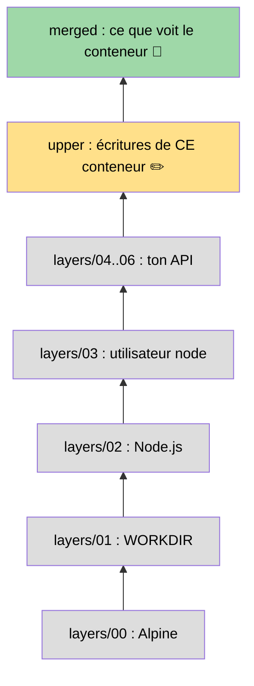
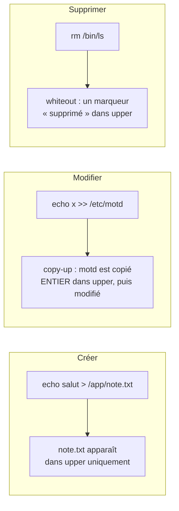
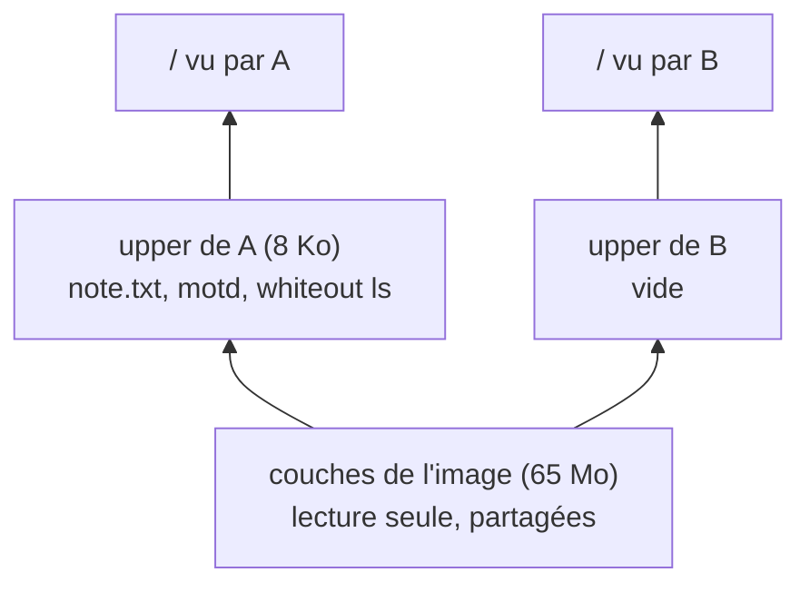

# Comprendre minibox

Ce document ré-explique, étape par étape, ce qu'on construit dans minibox et
pourquoi. Chaque étape reprend les **expériences réellement faites** sur la
machine, avec leur résultat.

---

## 0. L'idée de départ : un conteneur n'est qu'un processus

**Docker ne virtualise rien.** Un conteneur est un processus Linux ordinaire,
qui tourne sur le même noyau que tous les autres programmes de la machine.

Preuve : un `docker run alpine sleep 300`, vu depuis l'hôte.

```
$ ps -o pid,ppid,user,cmd -p <pid du conteneur>
    PID    PPID USER     CMD
 147460  147421 root     sleep 300                     ← le "conteneur"
 147421         /usr/bin/containerd-shim-runc-v2 ...    ← son parent
```

Ce qui change, c'est **ce que le processus voit**. Le noyau peut lui montrer une
version différente de certaines ressources : c'est le rôle des **namespaces**.

```
                  ┌─────────────────────────────────────────┐
                  │              NOYAU LINUX                 │
                  │            (un seul, partagé)            │
                  └─────────────────────────────────────────┘
                     ▲               ▲                 ▲
                     │               │                 │
              ┌──────┴─────┐  ┌──────┴─────┐   ┌───────┴──────┐
              │  firefox   │  │   bash     │   │ node (API)   │
              │            │  │            │   │ 👓 namespaces │
              │ vue normale│  │ vue normale│   │ vue à part   │
              └────────────┘  └────────────┘   └──────────────┘
                                                  "le conteneur"
```

> **Un conteneur = un processus + des namespaces (ce qu'il voit)
> + des cgroups (ce qu'il peut consommer) + un système de fichiers (l'image).**

| Ingrédient | Rôle | Étape |
|---|---|---|
| namespace **user** | il se croit root, sans l'être vraiment | 1 |
| namespace **UTS** | son propre hostname | 1 |
| namespace **PID** | ses propres numéros de processus | 2 |
| namespace **mount** | sa propre table de montages | 2 |
| **pivot_root** | les fichiers de l'image deviennent sa racine | 3 |
| **overlayfs** | il écrit sans abîmer l'image | 4 |
| **cgroups** | limite de mémoire et de CPU | 5 |
| namespace **réseau** | sa propre IP, ses propres ports | 6 |

Les namespaces actifs d'un processus sont visibles dans `/proc/<pid>/ns/` :

```
          hôte                    minibox (étape 1)
uts   uts:[4026531838]        uts:[4026534277]        ISOLÉ
user  user:[4026531837]       user:[4026534276]       ISOLÉ
pid   pid:[4026531836]        pid:[4026531836]        partagé
mnt   mnt:[4026531832]        mnt:[4026531832]        partagé
net   net:[4026531833]        net:[4026531833]        partagé
```

Même numéro = même namespace = même vue que l'hôte.

---

## 1. Étape 1 : user et UTS

### Comment minibox crée un conteneur

Les namespaces se créent **au moment où un processus naît** (appel système
`clone()`), grâce à des drapeaux. minibox se relance donc lui-même :

```
  Terminal
     │
     │  ./minibox run /bin/sh
     ▼
┌──────────────────────┐
│ minibox "run"        │  côté hôte, namespaces normaux
│                      │
│ clone() + drapeaux : │
│  CLONE_NEWUSER       │
│  CLONE_NEWUTS        │
└──────────┬───────────┘
           │  crée un enfant DANS de nouveaux namespaces
           ▼
┌──────────────────────┐
│ minibox "child"      │  déjà dans le conteneur
│                      │
│ 1. prépare le dedans │  (hostname, montages…)
│ 2. exec(/bin/sh)     │──┐
└──────────────────────┘  │ exec() remplace le programme :
                          │ même processus, même PID,
           ┌──────────────┘ mêmes namespaces
           ▼
┌──────────────────────┐
│ /bin/sh              │  ta commande, isolée
└──────────────────────┘
```

C'est exactement le rôle de `runc` chez Docker : il prépare le conteneur, puis
**s'efface** au profit de ton `node dist/index.js`.

### Le namespace UTS : un hostname à soi

```
--- hôte
hostname=omarchy
--- conteneur
hostname=minibox
après changement : pirate      ← le conteneur change SON hostname…
--- hôte, après
omarchy                        ← …celui de la machine ne bouge pas
```

C'est pour ça que les conteneurs Docker ont un hostname aléatoire
(`7da031d7e6a0`), et que celui d'Azure s'appelait `SandboxHost-…`.

### Le namespace user : root, mais seulement dans sa bulle

On donne au noyau une **table de correspondance** des utilisateurs :

```
       conteneur              hôte
     ┌───────────┐        ┌───────────┐
     │  uid 0    │ ─────► │ uid 1000  │
     │  (root)   │        │ (nathan)  │
     └───────────┘        └───────────┘
```

- **Dans** le conteneur : `id` affiche `uid=0`, il peut administrer **ses
  propres** namespaces (changer son hostname, monter des choses chez lui).
- **Pour le reste de la machine** : c'est toi, l'utilisateur 1000. Il ne peut
  rien faire de plus que toi.

Preuve que c'est indispensable :

```
$ unshare --uts hostname x        ← sans user namespace
unshare: Operation not permitted  ← il faudrait être vraiment root
```

C'est le mode **rootless** (celui de Podman) : aucun `sudo` nécessaire.

> **À retenir** : un namespace = une vue isolée d'une ressource.
> Le namespace user rend tout le reste possible sans être root.

---

## 2. Étape 2 : PID et mount

### Essai 1 : le namespace PID seul ne suffit pas

```
mon PID : 1                        ← le shell se croit PID 1…
processus visibles par ps : 476    ← …mais ps voit toute la machine ?!
```

Parce que **`ps` ne demande rien au noyau : il lit le dossier `/proc`**. Et ce
`/proc` était encore celui de l'hôte.

### `/proc` n'est pas un vrai dossier

```
0 octets  /proc/meminfo     ← "vide" sur le disque…
MemTotal: 15693872 kB       ← …mais affiche ta RAM
```

`/proc` est un **système de fichiers virtuel** : rien n'est stocké nulle part.
Chaque fois qu'un programme lit un fichier de `/proc`, **le noyau fabrique le
contenu à la volée**.

```
   ps ──── lit /proc/123/status ────►  NOYAU
                                          │  "je génère la réponse
   ps ◄─── "Name: sleep, State: S…" ──────┘   maintenant, à partir de
                                              mes structures internes"
```

### La solution : un `/proc` neuf, dans un namespace mount

On demande au noyau une **nouvelle instance** de procfs, liée à notre
namespace PID. Ce n'est **pas une copie** : le noyau génère son contenu en
direct, mais uniquement pour les processus de notre namespace.

Pour ne pas écraser le `/proc` de ton PC, il faut d'abord un **namespace
mount** : le conteneur a sa propre table de montages.

```
          table de l'HÔTE                  table du CONTENEUR
   ┌──────────────────────────┐    ┌──────────────────────────────┐
   │ /      → disque          │    │ /      → disque              │
   │ /proc  → procfs (hôte)   │    │ /proc  → procfs (hôte)       │ caché
   │ ...                      │    │ /proc  → procfs NEUF         │ ◄ visible
   └──────────────────────────┘    └──────────────────────────────┘
        inchangée                     le dernier montage recouvre
                                      le précédent
```

Résultat :

```
mon PID : 1
    PID USER     CMD
      1 root     ps -o pid,user,cmd      ← il ne voit plus que lui-même
--- /proc de l'hôte intact : 476 processus
```

### Un processus, deux numéros

Il n'y a **qu'un seul processus**, mais il a un numéro dans chaque namespace
PID où il est visible :

```
                 namespace PID de l'hôte
   ┌───────────────────────────────────────────────────┐
   │  1 systemd   …   150027 minibox   155657 sleep ◄──┼── même
   │                                     │             │   processus
   │       namespace PID du conteneur    │             │
   │      ┌──────────────────────────────┼─────┐       │
   │      │  1 sh          7 sleep ◄─────┘     │       │
   │      └────────────────────────────────────┘       │
   └───────────────────────────────────────────────────┘

$ grep NSpid /proc/155657/status
NSpid:  155657  7
```

L'hôte voit tout. Le conteneur ne voit que sa propre numérotation.

### Le mystère des 10 secondes du TD2

```
sleep normal :              arrêté par SIGTERM
sleep en PID 1 (minibox) :  TOUJOURS VIVANT après SIGTERM → seul SIGKILL l'arrête
```

Le noyau **protège le PID 1** (normalement `systemd`) : un signal ne lui est
transmis que s'il a prévu un gestionnaire pour ce signal. Un programme qui ne
gère pas `SIGTERM` l'ignore donc s'il est PID 1.

```
docker stop  ──SIGTERM──►  node (PID 1, pas de gestionnaire)  →  ignoré
     … 10 secondes …
docker stop  ──SIGKILL──►  node                                →  tué
```

Corrections possibles : gérer `SIGTERM` dans le code, ou `docker run --init`,
qui met un mini-init (`tini`) en PID 1 pour relayer les signaux.

### Le lien avec la question du TD2 Q4

`/proc/meminfo` est généré par le même noyau, et **il n'existe pas de
namespace mémoire**. Un conteneur voit donc toute la RAM de la machine, même
limité à 256 Mo. La limite (cgroups, étape 5) est réelle, mais invisible
dans `/proc`.

> **À retenir** : `/proc` est une fenêtre sur le noyau, pas un dossier.
> Isoler les processus = nouvelle numérotation (PID) + nouveau `/proc`
> (mount). Le PID 1 a un statut spécial pour les signaux.

---

## 3. Étape 3 : les fichiers de l'image

### Le problème

Après l'étape 2, le conteneur voyait encore **tous les fichiers de ton PC** :
ton `/home`, ton Node, ta configuration. Il dépendait donc de ce qui est
installé sur ta machine.

### Une image, c'est un dossier

```
$ ./export-rootfs.sh crazzybuilds/sysinfo-api:0.0.2 rootfs/sysinfo
crazzybuilds/sysinfo-api:0.0.2 extrait dans rootfs/sysinfo (65M)

rootfs/sysinfo/
├── app/            ← ton API (dist/, node_modules/, package.json)
├── bin/ lib/ usr/  ← Alpine et Node
├── etc/            ← la configuration d'Alpine
└── home/node/      ← l'utilisateur de l'image
```

Plus une configuration à part (`Cmd=[node dist/index.js]`, `WorkingDir=/app`,
`Env=PATH=…`).

### L'objectif : que ce dossier devienne `/`

```
  Avant : le conteneur voit            Après : le conteneur voit
  /         ← ton PC (Arch)            /          ← rootfs/sysinfo (Alpine)
  ├── home/nathan/…                    ├── app/
  ├── usr/bin/node (le tien)           ├── usr/bin/node (celui de l'image)
  └── etc/ (ta config)                 ├── etc/ (config d'Alpine)
                                       └── home/node/
```

Le programme ne sait pas qu'il est dans un sous-dossier : pour lui, `/` **est**
l'image.

### Comment : on modifie la table de montages du conteneur

**On ne touche jamais à ton ordinateur.** Tout se passe dans la table de
montages **du conteneur**, celle qu'il a reçue à l'étape 2 (namespace mount).

**① Bind mount** : `pivot_root` exige que la nouvelle racine soit un *point
de montage*, pas un simple dossier. On monte donc le dossier **sur lui-même**.
Rien n'est copié : c'est une « fenêtre » sur le même dossier, mais le noyau la
traite comme un montage à part entière, comme un disque.

```
  table du conteneur
  /                → disque (Arch)
  /…/rootfs/sysinfo → /…/rootfs/sysinfo   (bind : même dossier, vu comme un montage)
```

**② pivot_root** : on échange les deux lignes. L'image devient `/`, et
l'ancienne racine est rangée dans `/.oldroot`.

```
  table du conteneur
  /          → rootfs/sysinfo (Alpine)
  /.oldroot  → disque (Arch)               ← ton PC, encore accessible
```

**③ On emprunte ce qui manque** : un `/proc` neuf, et quelques périphériques
pris dans `/.oldroot/dev` (`null`, `zero`, `random`, `urandom`, `tty`). Sans
être vraiment root, on ne peut pas en créer, mais on peut monter ceux de
l'hôte.

**④ On coupe** : on démonte `/.oldroot`. Plus aucune ligne de la table ne mène
à ton PC.

```
  table du conteneur (finale)            table de l'hôte (jamais modifiée)
  /             → rootfs/sysinfo          /  → /dev/mapper/root
  /proc         → procfs neuf             …
  /dev/null     → /dev/null de l'hôte
  /dev/urandom  → /dev/urandom de l'hôte
  …
```

Vérifié sur la machine :

```
--- table des montages DANS le conteneur :
  /             (source: /@home/nathan/Projects/minibox/rootfs/sysinfo)
  /proc
  /dev/null, /dev/zero, /dev/random, /dev/urandom, /dev/tty
--- la racine de l'hôte :
  /             /dev/mapper/root           ← inchangée
```

### Pourquoi `pivot_root` et pas `chroot` ?

`chroot` change seulement **le point de départ des chemins** d'un processus :
l'ancienne racine existe toujours dans la table, et un processus root peut en
ressortir. `pivot_root` **déplace réellement la racine** du namespace mount,
et on supprime ensuite l'ancienne : il n'y a plus rien vers quoi s'échapper.
C'est ce qu'utilise `runc`.

### Le résultat : l'API tourne sans Docker

```
$ ./minibox run -rootfs rootfs/sysinfo -workdir /app node dist/index.js
Server listening on http://localhost:8000

$ curl localhost:8000/api/v1/sysinfo        (depuis l'hôte)
HTTP 200
os     : Alpine Linux v3.20 | hostname: minibox | noyau: 7.2.15-4-omarchy
procs  : 2 processus
mem    : 15.0 Go
cpu    : Ryzen 5 5500H with Radeon Graphics 8 threads
```

| Ce que voit l'API | Pourquoi |
|---|---|
| Alpine 3.20 (le PC est sous Arch) | les fichiers sont ceux de l'image (étape 3) |
| hostname `minibox` | namespace UTS (étape 1) |
| 2 processus | namespace PID + `/proc` neuf (étape 2) |
| noyau `omarchy` | **le noyau est partagé** : un conteneur n'a pas de noyau à lui |
| 15 Go, 8 threads | pas encore de limite, pas de namespace mémoire (étape 5) |

`curl localhost:8000` fonctionne depuis l'hôte parce que le **namespace réseau
est encore partagé** (étape 6).

### La limite qui mène à l'étape 4

Le conteneur écrit **directement dans le dossier de l'image** :

```
dans le conteneur :  echo coucou > /tmp/fichier
sur l'hôte :         rootfs/sysinfo/tmp/fichier   ← il est là, propriétaire nathan
```

Deux conteneurs lancés depuis ce dossier se marcheraient dessus, et l'image se
salirait. Docker ne recopie jamais l'image : il **empile ses couches en lecture
seule** et ajoute **une couche inscriptible par conteneur** (overlayfs).

> **À retenir** : une image = un dossier + une config. `pivot_root` en fait la
> racine du conteneur, en ne modifiant **que la table de montages du
> conteneur**. Seul le noyau vient de l'hôte, c'est ce qui rend les
> conteneurs portables.

---

## 4. Étape 4 : overlayfs, les couches de l'image

### Une image, ce sont des couches

`docker save` montre ce qu'est vraiment une image : **une pile d'archives**
(une par instruction du Dockerfile qui modifie des fichiers) et **une
configuration**.

```
$ ./pull-image.sh crazzybuilds/sysinfo-api:0.0.2 images/sysinfo
couche 00 : 9.1M   517 fichiers   ← FROM alpine:3.20
couche 01 : 0        1 fichiers   ← WORKDIR /app
couche 02 : 55M    413 fichiers   ← RUN apk add nodejs
couche 03 : 24K     10 fichiers   ← RUN addgroup / adduser
couche 04 : 4.0K     2 fichiers   ← COPY package.json
couche 05 : 908K    54 fichiers   ← COPY node_modules
couche 06 : 80K     15 fichiers   ← COPY dist

config.json : {"Cmd":["node","dist/index.js"], "WorkingDir":"/app", "Env":[…], "User":"node"}
```

Ce sont les couches que montrait `dive` au TD2. Chacune ne contient **que ce
que son instruction a ajouté ou modifié**.

### Ce que fait overlayfs : empiler des dossiers

overlayfs est un système de fichiers du noyau qui **superpose plusieurs
dossiers** et présente le résultat comme un seul.



| Dossier | Rôle | Accès |
|---|---|---|
| `lowerdir` (les 7 couches) | l'image | **lecture seule**, partagées par tous les conteneurs |
| `upperdir` | les modifications de **ce** conteneur | lecture-écriture |
| `workdir` | brouillon interne d'overlayfs | — |
| `merged` | la vue fusionnée, qui devient `/` du conteneur | ce que voit le programme |

Pour lire un fichier, overlayfs le cherche **de haut en bas** et prend le
premier trouvé : si `upper` en a une version, c'est elle, sinon on descend
dans les couches.

### Les trois cas d'écriture



Vérifié sur la machine, dans le `upper` du conteneur A :

```
./app/note.txt     regular file              ← créé
./etc/motd         regular file (11 lignes)  ← copie de l'original (10 lignes) + modif
./bin/ls           character special 0,0     ← whiteout : "ce fichier n'existe plus"
```

Le fichier original n'est **jamais** touché. Supprimer un fichier ne libère
donc aucune place : il reste dans sa couche, simplement masqué. C'est pour ça
que supprimer des fichiers dans un `RUN` à part ne réduit pas une image
Docker.

### Deux conteneurs, une seule image



```
=== conteneur B, même image :
cat: can't open '/app/note.txt'   ← il ne voit pas le fichier de A
/bin/ls                           ← ls existe toujours pour lui
```

C'est ce qui rend Docker rapide et économe :
- **démarrer un conteneur ne copie rien** : on crée trois dossiers vides et on
  monte un overlay ;
- **10 conteneurs de la même image** = 65 Mo d'image + 10 petits `upper` ;
- **des images différentes partagent leurs couches communes** : c'était le
  `Already exists` du `docker pull` de la Q8 (la couche Alpine était déjà là).

### Le montage, en une ligne

Le montage se fait **dans `child`**, donc dans le namespace mount du conteneur
(l'hôte ne le voit pas) :

```
overlay on / type overlay (lowerdir=…/layers/06:…/layers/05:…:…/layers/00,
                           upperdir=…/containers/ecc20b/upper,
                           workdir=…/containers/ecc20b/work,
                           userxattr)
```

- `lowerdir` : la couche **du dessus en premier** (d'où l'inversion dans le
  code) ;
- `userxattr` : l'option qui permet d'utiliser overlayfs **sans être root**
  (dans un user namespace).

### Comme `docker run`, sans commande

minibox lit maintenant `config.json` : sans commande, il lance le `Cmd` de
l'image, dans son `WorkingDir`, avec son `Env`.

```
$ ./minibox run -image images/sysinfo
minibox : conteneur f9a779 (containers/f9a779)
Server listening on http://localhost:8000
```

> **À retenir** : une image = des couches en lecture seule + une config. Un
> conteneur = ces couches + **une couche inscriptible à lui**, fusionnées par
> overlayfs. Écrire ne modifie jamais l'image : créer → dans `upper`,
> modifier → copie dans `upper`, supprimer → marqueur dans `upper`.

---

## Récapitulatif

```
  ./minibox run -image images/sysinfo
     │
     ├─ lit config.json (Cmd, WorkingDir, Env)                 (run)
     ├─ crée containers/<id>/{upper,work,merged}
     ├─ clone() avec CLONE_NEWUSER, NEWUTS, NEWPID, NEWNS
     │
     └─ dans l'enfant :                                         (child)
          ├─ uid 1000 → uid 0               namespace user
          ├─ sethostname("minibox")         namespace UTS
          ├─ montages privés                namespace mount
          ├─ mount overlay → merged         couches + upper
          ├─ bind + pivot_root sur merged   fichiers de l'image
          ├─ /proc neuf + /dev empruntés
          ├─ démontage de l'ancienne racine
          ├─ chdir /app + environnement de l'image
          └─ exec("node dist/index.js")     → PID 1 du conteneur
```

## Petit glossaire

| Terme | Définition courte |
|---|---|
| **noyau** | le cœur de Linux, qui gère processus, mémoire, fichiers, réseau. Un seul pour toute la machine |
| **processus** | un programme en cours d'exécution, avec un numéro (PID) |
| **namespace** | une vue isolée d'une ressource du noyau, donnée à un groupe de processus |
| **clone()** | l'appel système qui crée un processus, éventuellement dans de nouveaux namespaces |
| **exec()** | remplace le programme d'un processus par un autre, sans changer de PID |
| **montage** | une ligne de la table « tel dossier affiche tel contenu » |
| **bind mount** | monter un dossier à un autre endroit (ou sur lui-même), sans copie |
| **procfs** | le système de fichiers virtuel de `/proc`, généré par le noyau à chaque lecture |
| **pivot_root** | échange la racine du namespace mount avec un autre point de montage |
| **rootless** | conteneurs lancés sans être root, grâce au namespace user |

---

## Pour vérifier que c'est compris

<details>
<summary>1. Un conteneur Docker tourne-t-il dans une machine virtuelle ?</summary>

Non (sur Linux). C'est un processus de l'hôte, visible dans `ps`, qui partage
le noyau. Seules des solutions comme Azure (micro-VM) ou Docker Desktop sur
Mac/Windows ajoutent une VM.
</details>

<details>
<summary>2. Pourquoi minibox se relance-t-il lui-même au lieu de lancer directement la commande ?</summary>

Les namespaces se créent à la naissance d'un processus (`clone()`). L'enfant,
déjà dans les nouveaux namespaces, doit encore préparer l'intérieur (hostname,
montages, racine) **avant** de devenir la commande avec `exec()`.
</details>

<details>
<summary>3. Le conteneur est root : peut-il supprimer des fichiers système de mon PC ?</summary>

Non. Il est root seulement dans son namespace user. Pour le noyau, c'est
l'utilisateur 1000 : il n'a pas plus de droits que toi.
</details>

<details>
<summary>4. Pourquoi le namespace PID seul ne suffit-il pas à cacher les processus de l'hôte ?</summary>

Parce que `ps` lit `/proc`, et ce `/proc` était celui de l'hôte. Il faut monter
un procfs neuf, ce qui demande un namespace mount pour ne pas toucher celui de
l'hôte.
</details>

<details>
<summary>5. Quand on monte un nouveau /proc, est-ce qu'on copie les informations des processus ?</summary>

Non. `/proc` est virtuel : le noyau génère son contenu à chaque lecture. Le
nouveau procfs génère simplement la vue de notre namespace PID.
</details>

<details>
<summary>6. Pourquoi l'API ne s'arrête-t-elle pas avec un SIGTERM ?</summary>

Elle est PID 1 dans son namespace, et le noyau ne transmet un signal au PID 1
que s'il a un gestionnaire pour ce signal. Node n'en a pas pour `SIGTERM`.
</details>

<details>
<summary>7. Pendant pivot_root, la racine de mon PC est-elle déplacée ?</summary>

Non. Seule la table de montages **du conteneur** change. Pendant un instant,
ton PC y est visible dans `/.oldroot`, puis on supprime cette ligne. La table
de l'hôte n'est jamais modifiée.
</details>

<details>
<summary>8. Pourquoi faut-il monter le rootfs sur lui-même avant pivot_root ?</summary>

`pivot_root` exige que la nouvelle racine soit un point de montage. Le bind
mount transforme le dossier en point de montage, sans rien copier.
</details>

<details>
<summary>9. L'API dans minibox affiche le noyau "omarchy" et non un noyau Alpine. Pourquoi ?</summary>

Un conteneur n'a pas de noyau : seuls les fichiers viennent de l'image. Le
noyau est toujours celui de l'hôte.
</details>

<details>
<summary>10. Si deux conteneurs utilisent le même dossier rootfs/sysinfo, que se passe-t-il ?</summary>

Ils écrivent dans les mêmes fichiers et se marchent dessus, et l'image est
modifiée. C'est ce que règle overlayfs à l'étape 4.
</details>

<details>
<summary>11. Que contient une image Docker ?</summary>

Des couches (une archive par instruction du Dockerfile qui modifie des
fichiers) et une configuration (`Cmd`, `WorkingDir`, `Env`, `User`…). Pas de
noyau, pas de processus.
</details>

<details>
<summary>12. Le conteneur modifie /etc/motd. Qu'arrive-t-il au fichier de l'image ?</summary>

Rien. overlayfs copie d'abord le fichier entier dans `upper` (copy-up), et la
modification porte sur cette copie. Les couches de l'image restent en lecture
seule.
</details>

<details>
<summary>13. Pourquoi un `RUN rm gros-fichier` à part ne réduit-il pas la taille d'une image ?</summary>

Le fichier reste dans la couche qui l'a ajouté. La nouvelle couche ne contient
qu'un whiteout qui le masque. Il faut le supprimer dans le même `RUN` qui l'a
créé, ou utiliser un build multi-stage.
</details>

<details>
<summary>14. Pourquoi lancer un conteneur est-il presque instantané, même pour une grosse image ?</summary>

Rien n'est copié : on crée trois dossiers vides (`upper`, `work`, `merged`) et
on monte un overlay par-dessus les couches existantes.
</details>
