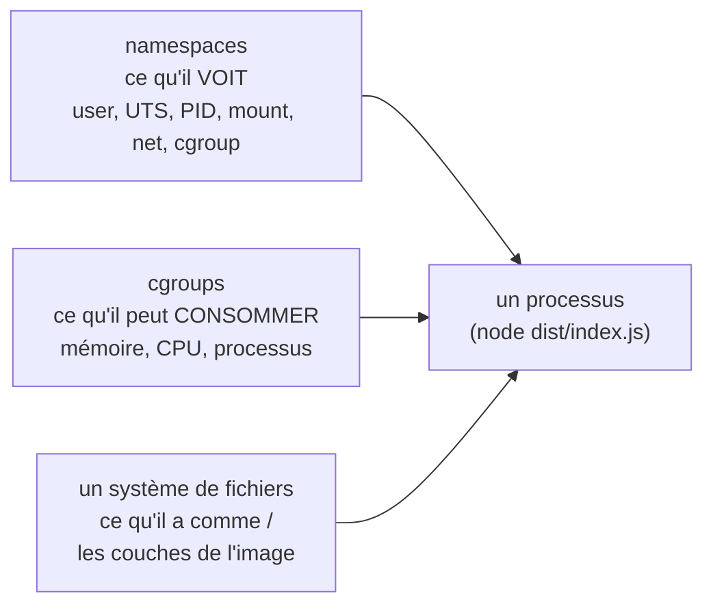
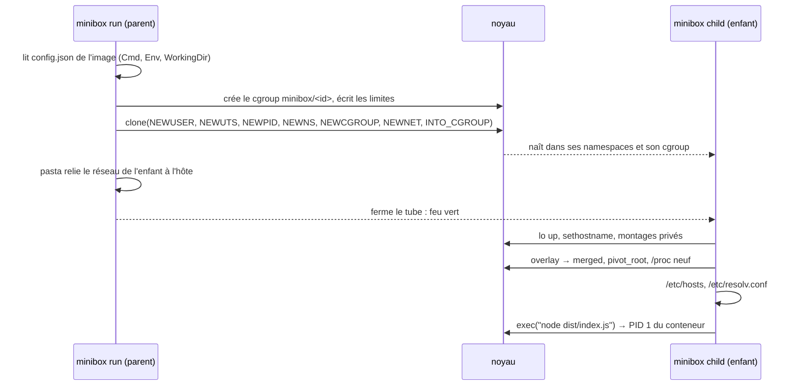

# Fiche — Piste 2 : minibox, un runtime de conteneurs à la main

> **La question** : qu'est-ce que Docker fait *vraiment* quand il lance un
> conteneur ?
> **La méthode** : le refaire, sans root et sans dépendance, en ~450 lignes de
> Go, une brique du noyau à la fois, jusqu'à lancer l'API `sysinfo` du TP.
> Le détail de chaque étape (schémas, sorties réelles) est dans
> [EXPLICATIONS.md](EXPLICATIONS.md).

---

## 1. L'idée en une image

**Un conteneur n'est qu'un processus Linux**, visible dans `ps` sur l'hôte,
auquel le noyau applique trois choses :

Pas de machine virtuelle, pas d'émulation : **le même noyau** pour l'hôte et
tous les conteneurs (c'est ce que mesure la piste 1).

---

## 2. Le parcours, étape par étape

| Étape | Brique | Ce que fait minibox | Ce qu'on a vu |
|---|---|---|---|
| 1 | namespaces **user** + **UTS** | `clone(CLONE_NEWUSER \| CLONE_NEWUTS)`, uid 1000 → 0 | root dans le conteneur, toi pour le noyau ; un hostname à soi |
| 2 | namespaces **PID** + **mount** | `CLONE_NEWPID \| CLONE_NEWNS`, un `/proc` neuf | 2 processus au lieu de ~500 ; un processus a un PID par namespace (`NSpid`) |
| 3 | **racine** de l'image | bind mount + `pivot_root`, démontage de l'ancienne racine | l'API tourne sur l'Alpine de l'image, sans Docker |
| 4 | **overlayfs** | couches en lecture seule + une couche `upper` par conteneur | deux conteneurs, une seule copie de l'image ; *copy-up* à la 1ʳᵉ écriture |
| 5 | **cgroups v2** | un dossier, une limite = un fichier (`memory.max`, `cpu.max`, `pids.max`) | tué à 256 Mo (code 137), 50 % de CPU obtenus, `fork` refusé |
| 6 | namespace **réseau** | pile vide, `lo` à monter soi-même, `pasta` pour relier à l'hôte | deux `localhost` différents ; `-p 8123:8000` comme Docker |
| 7 | namespace **cgroup** + faux `/proc/meminfo` | le conteneur peut lire ses limites, ou les voir dans `/proc` | `sysinfo` affiche enfin 256 Mo |

---

## 3. Le flux complet

**Pourquoi minibox se relance-t-il lui-même** (`/proc/self/exe child`) ? Les
namespaces se créent à la *naissance* d'un processus. L'enfant, déjà dedans,
doit encore préparer l'intérieur (hostname, montages, racine) **avant** de
devenir la commande avec `exec()`. runc fait exactement pareil.

---

## 4. Les idées à retenir

> [!tip] `/proc` est une fenêtre, pas un dossier
> Le noyau génère `/proc` à chaque lecture, pour le namespace PID de celui qui
> le monte. Isoler les processus = nouvelle numérotation (PID) **+** nouveau
> `/proc` (mount). Avec le seul namespace PID, `ps` voyait encore ~500
> processus : il lisait le `/proc` de l'hôte.

> [!tip] Le PID 1 est spécial
> Le noyau ne lui transmet un signal que s'il a un gestionnaire. `node` sans
> gestionnaire de `SIGTERM` l'ignore : c'est **les 10 secondes de `docker stop`
> du TD2** (SIGTERM ignoré, puis SIGKILL). Solutions : gérer SIGTERM, ou
> `docker run --init`.

> [!tip] Changer de racine ne déplace rien
> `pivot_root` ne modifie que **la table de montages du conteneur** (son
> namespace mount). La racine de ton PC ne bouge pas. Contrairement à
> `chroot`, l'ancienne racine est ensuite démontée : impossible d'en sortir
> avec un `cd ..` bien placé.

> [!tip] Une image, ce sont des couches
> overlayfs empile les couches (lecture seule) et une couche `upper` propre au
> conteneur. Modifier un fichier = le copier dans `upper` (*copy-up*) ;
> supprimer = poser un *whiteout*. N conteneurs partagent la même image.

> [!tip] Les limites sont réelles, mais invisibles
> Les cgroups limitent vraiment (le noyau a tué l'API à 256 Mo), mais
> `/proc/meminfo` décrit toujours **la machine entière** : il n'existe pas de
> namespace mémoire. C'est la réponse à **la question 4 du TD2** (`sysinfo`
> affiche 15 Go dans un conteneur limité à 256 Mo).

| | Ce que dit `sysinfo` | La réalité (le cgroup) |
|---|---|---|
| mémoire | **15 Go** | `memory.max` : **256 Mo** |
| CPU | **8** | `cpu.max` : **0,5 CPU** |

---

## 5. Ce qu'on a mesuré

| Expérience | Résultat |
|---|---|
| allouer 10 Mo en boucle, `-memory 256M` | tué après 200 Mo alloués, **code 137** (128 + SIGKILL), `memory.events : oom_kill 1` |
| calcul de 3 s, `-cpus 0.5` / `0.25` | **1 498 ms / 750 ms** de CPU obtenus (50 % / 25 %) : *throttling* |
| lancer 20 `sleep`, `-pids 10` | `can't fork` : la protection contre les *fork bombs* |
| démarrer `/bin/true` (piste 1) | **9 ms**, contre ~415 ms pour `docker run` : le coût de Docker est dans sa chaîne de démons, pas dans le conteneur |

---

## 6. Les pièges rencontrés

| Symptôme | Cause | Leçon |
|---|---|---|
| `ps` voit ~500 processus malgré le namespace PID | il lit le `/proc` de l'hôte | il faut aussi un namespace mount et un `/proc` neuf |
| `kill -TERM` sans effet sur l'API | PID 1 sans gestionnaire de signal | le mystère des 10 s de `docker stop` |
| `pkill -f 'node dist/index.js'` tue… le shell qui le lance | le motif apparaît aussi dans sa propre ligne de commande | viser des PID précis (`NSpid`) |
| pas de DNS dans le conteneur réseau | l'hôte utilise `127.0.0.53`, qui n'existe pas dans le namespace | `pasta --dns-forward` + un `resolv.conf` écrit par minibox |
| la sonde de la piste 1 met **5 s** à démarrer | pas d'`/etc/hosts` : résoudre « minibox » part en DNS et attend le timeout | minibox écrit `/etc/hosts`, comme Docker |
| `rm -rf containers/` refusé | overlayfs crée `work/work` sans droits | `chmod -R u+rwx` avant de supprimer |

---

## 7. Ce que minibox ne fait pas (et Docker si)

- **un seul uid mappé** : la commande tourne en root dans le conteneur
  (Podman ou Docker en mode rootless mappent toute une plage d'uid, souvent
  65 536, déclarée dans `/etc/subuid`) ;
- **pas de seccomp, de capabilities ni d'AppArmor** : les filtres qui
  restreignent les appels système permis (piste 1 : Docker a un filtre
  seccomp actif, `Seccomp: 2`) ;
- **pas de whiteouts OCI** à l'extraction des couches ;
- **faux `/proc/meminfo` figé** au démarrage (lxcfs le régénère à chaque
  lecture, via FUSE) ;
- **pas de `--init`** ni de démon, d'API, de registre, de logs…

---

## 8. Questions pour vérifier

1. Un conteneur Docker tourne-t-il dans une machine virtuelle ?

Non (sur Linux). C'est un processus de l'hôte, visible dans <code>ps</code>, qui partage le noyau. Azure (TD4) ou Docker Desktop sur Mac/Windows ajoutent une VM en dessous.

2. Le conteneur est root : peut-il supprimer des fichiers système de mon PC ?

Non. Il est root seulement dans son namespace user. Pour le noyau, c'est l'utilisateur 1000 : il n'a pas plus de droits que toi.

3. Pourquoi le namespace PID seul ne suffit-il pas à isoler `ps` ?

<code>ps</code> lit <code>/proc</code>, qui est celui de l'hôte tant qu'on n'en monte pas un neuf. Il faut un namespace mount pour monter un <code>/proc</code> généré pour le nouveau namespace PID.

4. Pourquoi `docker stop` attendait-il 10 s au TD2 ?

node est PID 1 sans gestionnaire de SIGTERM : le noyau ne lui transmet pas le signal. Docker attend 10 s puis envoie SIGKILL.

5. Deux conteneurs de la même image : combien de copies de l'image sur le disque ?

Une seule. overlayfs empile les mêmes couches en lecture seule ; chaque conteneur n'a que sa couche <code>upper</code>, qui ne contient que ce qu'il a modifié.

6. Comment limiter un conteneur à 256 Mo, concrètement ?

Créer un dossier dans <code>/sys/fs/cgroup</code>, écrire <code>268435456</code> dans son <code>memory.max</code> (et 0 dans <code>memory.swap.max</code>), puis y mettre le processus. Au-delà, le noyau le tue (code 137).

7. Pourquoi `sysinfo` affiche-t-il 15 Go dans un conteneur limité à 256 Mo ?

<code>/proc/meminfo</code> décrit la machine (pas de namespace mémoire) ; la limite vit dans le cgroup, que <code>sysinfo</code> ne lit pas. Solutions : lire le cgroup (Node <code>process.constrainedMemory()</code>), ou un faux <code>/proc/meminfo</code> (lxcfs, ou l'option <code>-fake-meminfo</code>).

8. Pourquoi minibox démarre-t-il 50× plus vite que `docker run` ?

Le cœur est identique (clone, cgroup, pivot_root, exec) ; Docker ajoute une chaîne client → dockerd → containerd → shim → runc, plus l'overlay et le réseau à préparer.

